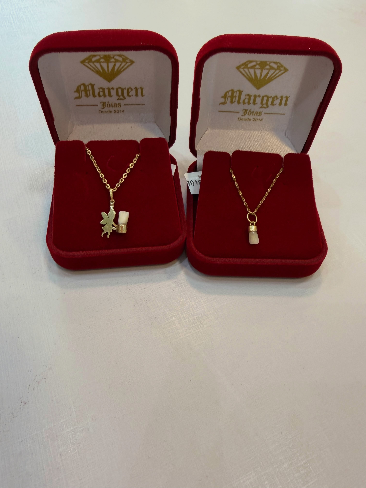
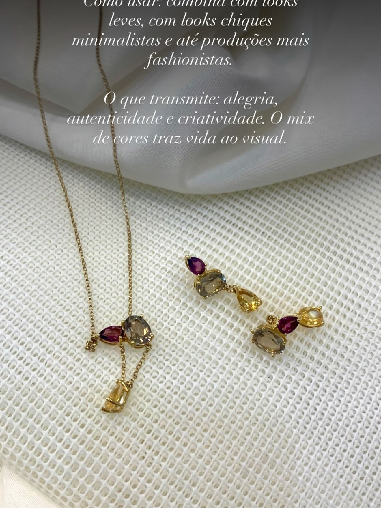
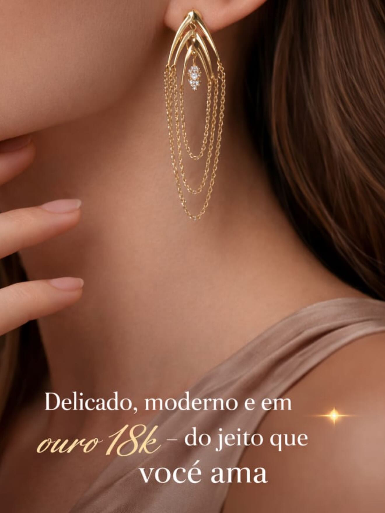
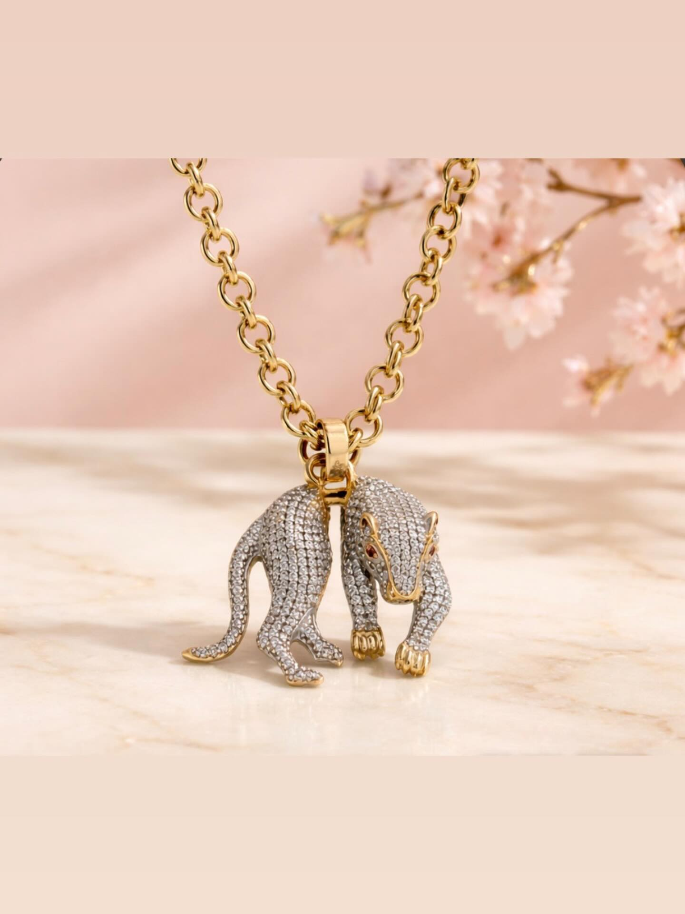
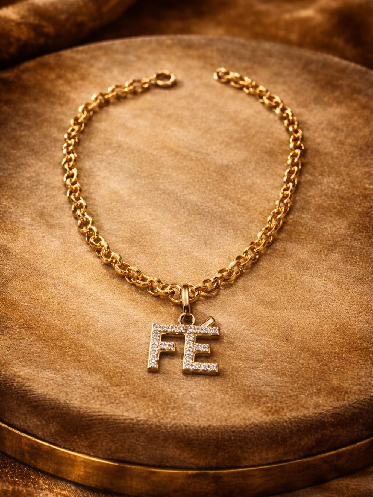
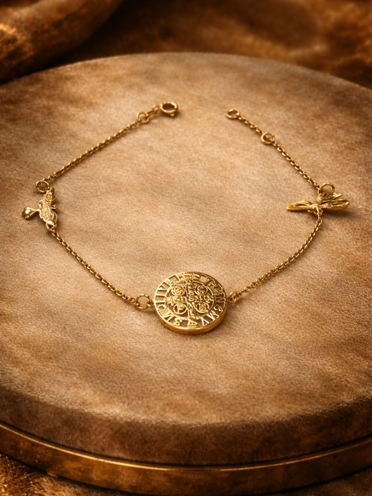
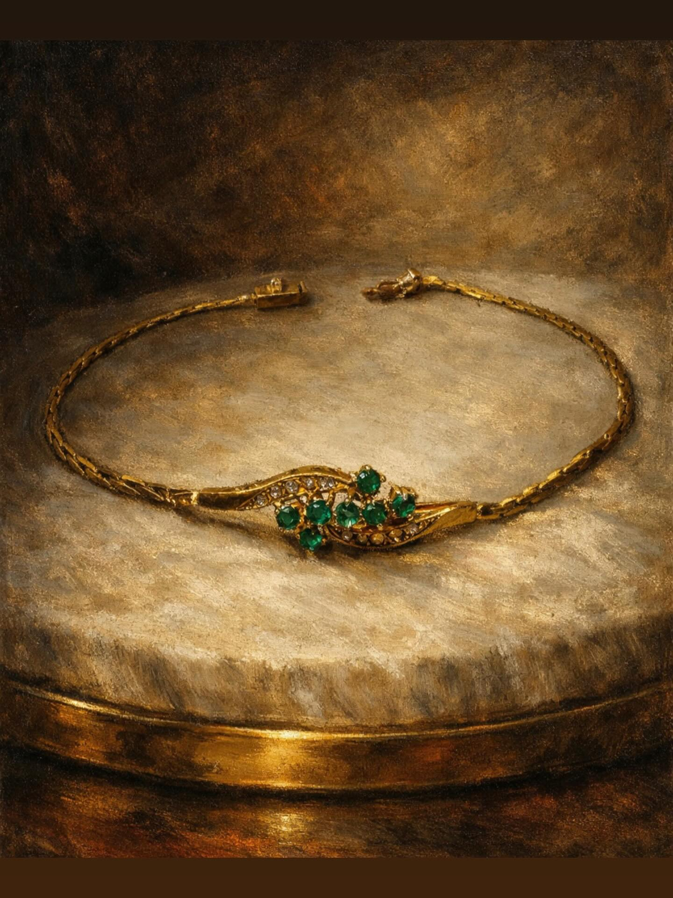
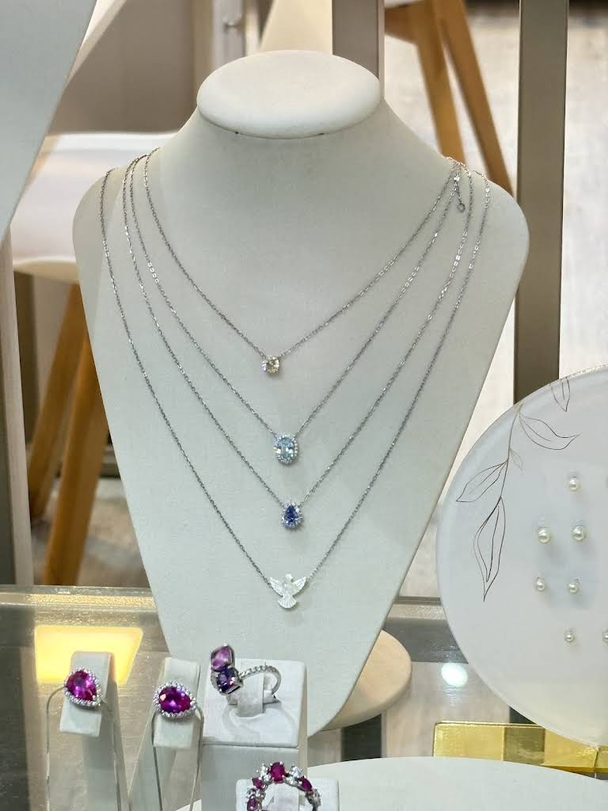
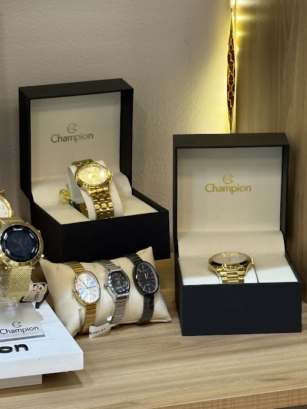
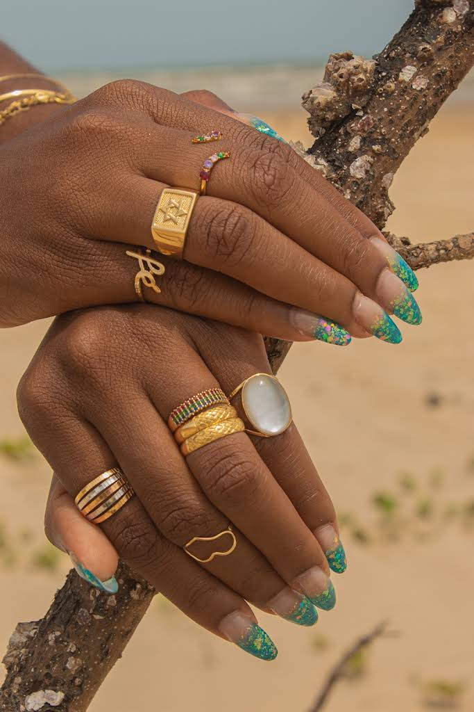

# Margen Joias — seleção de produtos

Coleta em 11/09/2026 · **10 fotos: 7 Instagram + 3 Google Maps**.

Arquivos originais exportados, com nomes organizados. As fotos mostram peças e composições; os nomes abaixo são editoriais. Preços, estoque e medidas precisam ser consultados.

[Dados para integração](catalogo.json) · [Briefing da landing page](BRIEFING.md)

| ID | Seleção | Fonte | Resolução |
|---|---|---|---|
| MJ-01 | Colares com pingentes afetivos | Instagram | 3024 × 4032 |
| MJ-02 | Colar e brincos com pedras coloridas | Instagram | 1320 × 1760 |
| MJ-03 | Brincos de correntes em ouro 18k | Instagram | 1320 × 1760 |
| MJ-04 | Colar pantera com elos portugueses | Instagram | 1440 × 1920 |
| MJ-05 | Pulseira Fé em ouro 18k | Instagram | 1365 × 1820 |
| MJ-06 | Pulseira com medalha e símbolos | Instagram | 1365 × 1820 |
| MJ-07 | Pulseira com esmeraldas | Instagram | 1440 × 1920 |
| MJ-08 | Seleção de colares com pingentes | Google Maps | 768 × 1024 |
| MJ-09 | Relógios Champion na vitrine | Google Maps | 508 × 677 |
| MJ-10 | Composição de anéis | Google Maps | 683 × 1024 |

## MJ-01 — Colares com pingentes afetivos

Dois colares de tonalidade dourada com pequenos pingentes claros, apresentados em estojos vermelhos da Margen.

**Informações da fonte:** A publicação associa as joias à história pessoal e ao ouro. Os estojos trazem a inscrição Desde 2014.

**Uso na página:** Presentes e joias com significado. Foto recente com embalagem da marca.

**A conferir:** Confirmar composição dos pingentes e se os colares são vendidos separadamente.

[Publicação de origem](https://www.instagram.com/margenjoias/p/Dcyz3O1FBdf/) · Data: 2026-09-02 · [Arquivo da foto](imagens/01-colares-pingentes-afetivos.jpg)

## MJ-02 — Colar e brincos com pedras coloridas

Colar e par de brincos com elementos ovais e em gota, em tons vinho, amarelo e acinzentado, sobre tecido claro.

**Informações da fonte:** A legenda apresenta pedras naturais e ouro 18k. Não informa quais gemas compõem o conjunto.

**Uso na página:** Seção de pedras coloridas ou galeria de conjuntos.

**A conferir:** Foto contém texto sobreposto na parte superior. Confirmar espécies das gemas e venda conjunta ou separada.

[Publicação de origem](https://www.instagram.com/margenjoias/p/DYVRgw_lDo9/) · Data: 2026-05-14 · [Arquivo da foto](imagens/02-colar-brincos-pedras-coloridas.jpg)

## MJ-03 — Brincos de correntes em ouro 18k

Brinco alongado em uso, com arcos dourados, correntes finas em camadas e detalhe central brilhante.

**Informações da fonte:** A legenda informa ouro 18k 750 e brilhantes. O texto impresso na imagem também informa ouro 18k.

**Uso na página:** Seção de brincos; imagem em uso para mostrar o caimento.

**A conferir:** Há texto sobreposto na base. A foto mostra um lado; confirmar venda por par e dimensões.

[Publicação de origem](https://www.instagram.com/margenjoias/p/DW6whrajj-n/) · Data: 2026-04-09 · [Arquivo da foto](imagens/03-brincos-correntes-ouro18k.jpg)

## MJ-04 — Colar pantera com elos portugueses

Corrente de elos redondos com pingente em forma de pantera, superfície brilhante clara e detalhes dourados, em fundo rosado.

**Informações da fonte:** A legenda identifica elos portugueses em ouro 18 e o motivo pantera.

**Uso na página:** Destaque principal da vitrine e imagem de abertura em composição dividida com texto.

**A conferir:** Não estender o teor da corrente ao pingente sem confirmação. Não identificar as pedras como diamantes pela foto.

[Publicação de origem](https://www.instagram.com/margenjoias/p/DWg9g2TE4oq/) · Data: 2026-03-30 · [Arquivo da foto](imagens/04-colar-pantera-elos-portugueses.jpg)

## MJ-05 — Pulseira Fé em ouro 18k

Pulseira de elos dourados com pingente escrito FÉ, com pequenos pontos brilhantes claros, sobre apoio dourado.

**Informações da fonte:** A legenda informa ouro 18k 750. O pingente FÉ é identificado visualmente.

**Uso na página:** Produto de destaque e seção de presentes com significado.

**A conferir:** Confirmar composição dos pontos brilhantes, comprimento e peso.

[Publicação de origem](https://www.instagram.com/margenjoias/p/DWgybzdjrhn/) · Data: 2026-03-30 · [Arquivo da foto](imagens/05-pulseira-fe-ouro18k.jpg)

## MJ-06 — Pulseira com medalha e símbolos

Pulseira delicada de tonalidade dourada com medalha circular trabalhada e pequenos símbolos laterais.

**Informações da fonte:** A legenda menciona ouro e símbolos. A medalha e os elementos laterais são descritos a partir da imagem.

**Uso na página:** Seção de presentes e pulseiras delicadas.

**A conferir:** Confirmar nome comercial, significado dos símbolos e teor do ouro.

[Publicação de origem](https://www.instagram.com/margenjoias/p/DWgx6HKjpoF/) · Data: não registrada · [Arquivo da foto](imagens/06-pulseira-medalha-simbolos.jpg)

## MJ-07 — Pulseira com esmeraldas

Pulseira de tonalidade dourada com motivo central curvo, pedras verdes em composição floral e pequenos pontos brilhantes.

**Informações da fonte:** A legenda associa a peça ao ouro e à esmeralda. Não informa quilatagem ou características gemológicas.

**Uso na página:** Destaque para joias com pedras coloridas.

**A conferir:** Confirmar teor do ouro, especificação das esmeraldas e tipo das pedras claras.

[Publicação de origem](https://www.instagram.com/margenjoias/p/DWgunTlji7L/) · Data: não registrada · [Arquivo da foto](imagens/07-pulseira-esmeraldas.jpg)

## MJ-08 — Seleção de colares com pingentes

Quatro colares de tonalidade prateada em expositor branco, com pingentes claros e azuis e um motivo de pássaro.

**Informações da fonte:** Foto publicada pelo perfil comercial no Google Maps em julho de 2026; sem ficha técnica individual.

**Uso na página:** Galeria da loja e variedade de colares.

**A conferir:** Tonalidade prateada não confirma prata nem ouro branco. Confirmar materiais e pedras de cada colar.

[Publicação de origem](https://www.google.com/maps/place/Margen+Joias+%7C+Joias+em+Ouro+18k+para+todos+os+estilos/@-10.932819,-37.0502016,17z/data=!3m1!4b1!4m6!3m5!1s0x71ab30f76953275:0x7e48645c73b64a82!8m2!3d-10.932819!4d-37.0502016!16s%2Fg%2F11p5g5mshx) · Data: 2026-07 · [Arquivo da foto](imagens/08-colares-expositor-maps.jpg)

## MJ-09 — Relógios Champion na vitrine

Relógios analógicos em diferentes acabamentos, junto de estojos com a marca Champion, na vitrine da loja.

**Informações da fonte:** Foto do perfil comercial no Google Maps em julho de 2026. Champion é legível nos estojos.

**Uso na página:** Cartão compacto da categoria relógios.

**A conferir:** Resolução de 508 × 677 px: evitar banner amplo e ampliação. Confirmar modelo, mecanismo e resistência à água.

[Publicação de origem](https://www.google.com/maps/place/Margen+Joias+%7C+Joias+em+Ouro+18k+para+todos+os+estilos/@-10.932819,-37.0502016,17z/data=!3m1!4b1!4m6!3m5!1s0x71ab30f76953275:0x7e48645c73b64a82!8m2!3d-10.932819!4d-37.0502016!16s%2Fg%2F11p5g5mshx) · Data: 2026-07 · [Arquivo da foto](imagens/09-relogios-champion-maps.jpg)

## MJ-10 — Composição de anéis

Diversos anéis em mãos, com tonalidades douradas, elementos coloridos, peça oval clara, formas geométricas e a palavra fé.

**Informações da fonte:** Foto do perfil comercial no Maps, publicada em março de 2023; a interface indica captura em dezembro de 2022.

**Uso na página:** Referência de estilo e variedade de anéis, sujeita à atualização da coleção.

**A conferir:** Foto antiga: confirmar disponibilidade de cada modelo. Materiais, pedras e tamanhos não informados.

[Publicação de origem](https://www.google.com/maps/place/Margen+Joias+%7C+Joias+em+Ouro+18k+para+todos+os+estilos/@-10.932819,-37.0502016,17z/data=!3m1!4b1!4m6!3m5!1s0x71ab30f76953275:0x7e48645c73b64a82!8m2!3d-10.932819!4d-37.0502016!16s%2Fg%2F11p5g5mshx) · Data: 2023-03 · [Arquivo da foto](imagens/10-aneis-composicao-maps.jpg)
